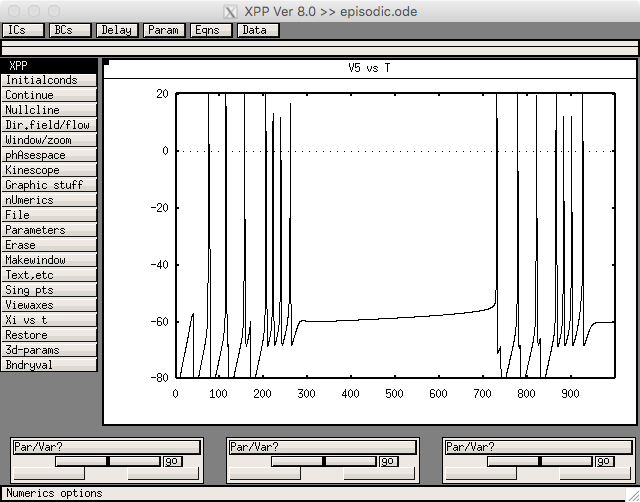
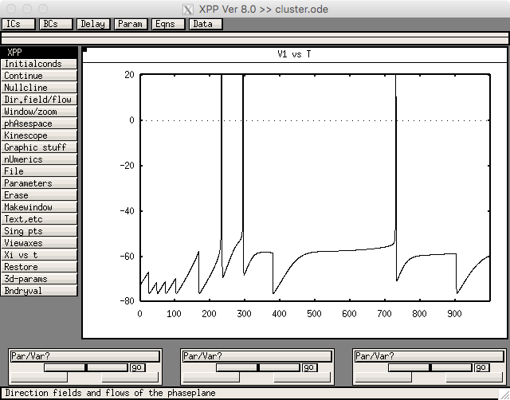
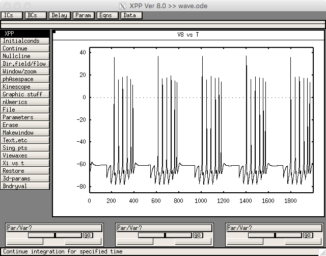
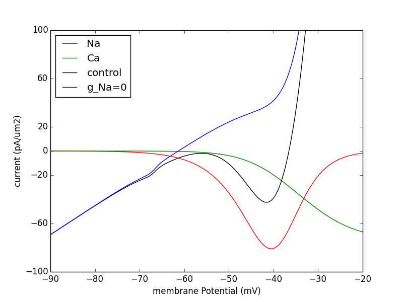

# Models Associated with the Paper

Terman D, Rubin JE, Yew AC, Wilson CJ (2002)  
Activity patterns in a model for the subthalamopallidal network of the basal ganglia.  
[J Neurosci](http://www.jneurosci.org/content/22/7/2963.full) 22:2963-76

The xpp files were provided by David Terman, and the partial NEURON implementation was provided by Taylor Malone.

xpp [http://www.math.pitt.edu/~bard/xpp/xpp.html](http://www.math.pitt.edu/~bard/xpp/xpp.html) and NEURON [https://neuron.yale.edu/neuron/](https://neuron.yale.edu/neuron/) simulation environments are each freely available.

To run the xpp code, download and extract this archive.

---

## Figure 3

Figure 3 was created with episodic.ode. Run with linux/unix commands like  
`xppaut episodic.ode`  
Then select File -> Read set: episodic.ode.set  
Then select Initial Conds. -> Go and you should see a graph like:  
  
which is similar to the STN cells in figure 3c.

---

## Figure 5

Figure 5 was created from cluster.ode. Run cluster with linux/unix commands like  
`xppaut cluster.ode`  
Then select File -> Read set: cluster.ode.set  
Then select Initial Conds. -> Go and you should see a graph like:  
  
which is similar to the GPe cells in figure 5c in the paper.

---

## Figure 7

Figure 7 was created from wave.ode. Run with linux/unix commands like  
`xppaut wave.ode`  
Then select File -> Read set: wave.ode.set  
Then select Initial Conds. -> Go and you should see a graph like:  
  
which is similar to the STN cells in figure 7c in the paper.

---

## NEURON Code

The NEURON code was created by Taylor Malone. Figures 1, 2, and 3c are reproduced however there are discrepancies with the network runs. We invite the modeling community to help us correct and/or finish the NEURON implementation.

To run the NEURON implementation, compile the mod files (see [https://senselab.med.yale.edu/ModelDB/NEURON_DwnldGuide.cshtml](https://senselab.med.yale.edu/ModelDB/NEURON_DwnldGuide.cshtml) for more help if necessary).

In linux/unix, for example:  
```
cd nrnfiles
nrnivmodl
python -i Figures/Fig_1a.py
```
produces the graph  


---

20171112 update from David Terman: suggestion to use the ode.set files

---

2025-07-10: Converted README to Markdown.